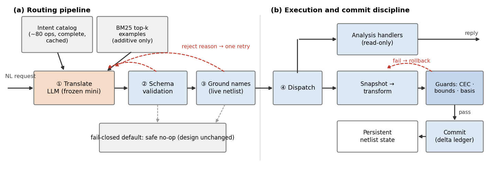
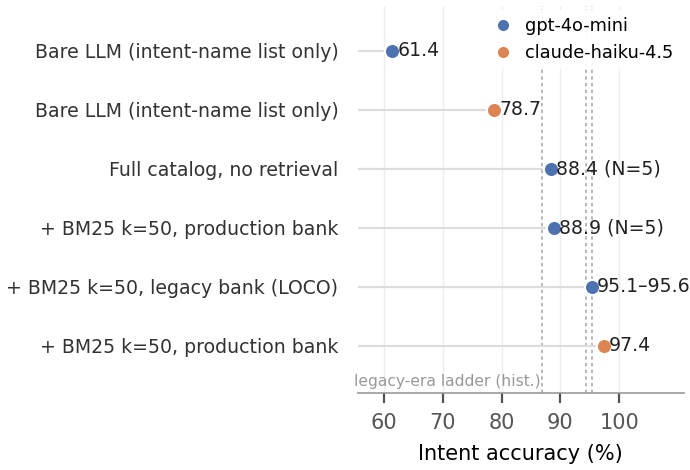

# Routing, Not Reasoning: A Fail-Closed LLM Agent for Natural-Language Netlist Transformation

> Draft v1 for advisor review (2026-11-09).

## Abstract

Natural-language interfaces are entering EDA workflows under two constraints
that tighten together. First, chip designs are confidential IP: netlists should
not leave the premises, which in practice locks model choice to small, frozen,
locally deployable models rather than frontier cloud LLMs. Second, functional
correctness is a hard limit, not a quality score: like an LEC sign-off gate, a
functionally corrupted netlist that silently reaches downstream stages is
catastrophic. In this small-model x hard-correctness regime, the prevailing
agent architecture — the LLM authors an artifact, verification screens it
afterwards — stakes correctness on verification coverage. We present a
fail-closed architecture instead: the LLM is confined to translating one
sentence into one intent from a schema-validated closed world of about 80
operations that cannot express an unsafe act; a deterministic engine performs
all circuit work, and every netlist mutation must pass functional equivalence
(register-cut CEC), structural-bound, and gate-basis checks or be rolled back.
Hallucination damage is thereby structurally capped at mis-routing. Using the
ICCAD 2026 CAD Contest Problem A as a testbed — it formalizes exactly these two
constraints — we run a controlled study on 1,420 real requests asking what
actually limits routing accuracy for small frozen models: a full intent catalog
alone yields 88.4% (five-run range 0.4) with gpt-4o-mini; retrieval value
depends jointly on example-bank quality and model (weak bank +0.5 pt, high-
recall bank +6.4 pt, while claude-haiku-4.5 reaches 97.4% on the weak bank);
the bottleneck is near-synonym intent discrimination throughout; supervised
classifiers top out at 73.3% and cannot substitute. Fault injection shows 24/24
corrupted dispatches cause no unsafe commit. The system sustains zero
hard-requirement violations across 231 official testcases, and an improved
configuration exceeds the top contest entry's official score (§5).

## 1. Introduction

Natural-language interfaces are rapidly entering EDA workflows: conversational
design Q&A, tool-script generation, automatic RTL repair. Deploying them in a
real design environment, however, tightens two constraints at once. First,
**model capability is pinned to the small end**: chip designs are a company's
most sensitive IP, so netlists and design intent should not leave the internal
network (the on-prem motivation behind ChipNeMo), while interactive use demands
low per-request latency and cost. The realistic choice is a small, *frozen*,
locally deployable or mini-class model — not a frontier cloud LLM — and most
teams have no standing fine-tuning pipeline. Second, **correctness is a hard
limit, not a quality score**: in a production flow, equivalence is a sign-off
gate in the spirit of LEC, and a functionally corrupted netlist that reaches
downstream stages is catastrophic. The most dangerous failure mode is not an
agent answering a question wrongly, but an agent *silently* corrupting the
design while reporting success.

This small-model x hard-correctness regime strikes precisely at the weak point
of the prevailing agent architecture. Existing LLM-EDA agents share one
structure: the LLM authors some artifact — tool-invocation scripts (ChatEDA),
repaired RTL (RTLFixer), or generated code (the VerilogEval line) — and
compilers or tests screen it afterwards. Post-hoc checking catches errors, but
errors retain *a path into the product*; a smaller model raises the traffic on
that path, and a frozen model closes the fine-tuning escape route. Under hard
correctness, generate-then-verify stakes the system's correctness on the
coverage of its verifier. What, then, should an agent look like in this regime?

The ICCAD 2026 CAD Contest Problem A (LLM-assisted netlist exploration and
transformation) formalizes this regime as a measurable testbed: a system
receives free-form natural-language requests line by line on a persistent,
evolving gate-level Verilog netlist, performing analysis (depth, cones, paths,
equivalence), structural edits (buffer insertion, basis conversion), and
optimization (depth / gate count), replying in lock-step. The organizers
mandate two frozen mini-class models (gpt-4o-mini, claude-haiku-4.5), forbid
fine-tuning, and score all-or-nothing: violating any hard requirement zeroes
the testcase and forfeits everything after it. We use it as our evaluation
vehicle: its two rules instantiate exactly the two constraints above.

Our answer inverts the architecture: **the LLM is a translator, not a
reasoner**. Its sole job is to translate one sentence into one intent object
living in a closed world — about 80 schema-validated intents whose required
and optional parameters carry types and closed enumerations — **which cannot
express an unsafe operation**. A deterministic engine performs all circuit
work; every netlist mutation must pass three pre-commit gates — a register-cut
combinational equivalence proof (sound sequential equivalence for this DFF
model), structural-bound recomputation, and gate-basis purity — or roll back to
the pre-edit snapshot. Hallucination damage is thus *structurally* capped: the
worst case is a mis-routed request (one wrong answer), never a functionally
corrupted netlist leaving the system (a zeroed testcase).

With correctness guaranteed by construction, a clean scientific question
emerges: **what actually limits routing accuracy for small frozen models?** We
run a controlled, leave-one-testcase-out study on the testbed's 1,420 real
requests, with several counter-intuitive findings: (i) the relation between
retrieval recall and end-to-end accuracy **depends on the model** —
claude-haiku-4.5 reaches 97.4% on an example bank whose recall@50 is only
82.1% (decoupling holds), while gpt-4o-mini is sensitive to bank quality
(95.1/95.6 on a high-recall legacy bank vs 88.9 on the weak bank, +6.4 pt);
(ii) at identical configuration, switching models is worth **+8.5 pt** (97.4
vs 88.9), an order of magnitude beyond any retrieval engineering; (iii) in
73–99% of failures the correct intent was already in context — the
bottleneck is near-synonym discrimination, not retrieval; (iv) supervised
classifiers (TF-IDF + LinearSVC with all labeled data) top out at 73.3%
(sentence embeddings: 72.8%), 15.6–24.1 pt below the deployed LLM pipeline;
(v) regex-first hybrid routing can be net-negative versus pure LLM routing, because mis-intercepted requests never reach the LLM.

These measurements sit behind a layer of validity engineering: we once
recorded silent API degradation disguising an infrastructure failure as model
failure — a plausible-looking 67.2% against a true 97.8% — and the resulting
telemetry (degraded-call counting, invalid-run gating) has since caught two
real incidents (§4.7).

End to end: zero hard-requirement violations across 231 official testcases
(40 public + 91 beta + 100 final), every output netlist ABC-verified
equivalent; the only beta losses trace to semantic ambiguities later settled
by official rulings, and final-round losses reduce to optimization cost ratios
(§5). Under fault injection, 24/24 corrupted dispatches caused no unsafe
commit.

Contributions:

- **C1 (architecture).** A fail-closed LLM netlist agent: closed-world intent
  contract, three pre-commit guards, snapshot rollback; hallucination damage
  structurally capped at mis-routing. Zero hard-requirement violations on 231
  official testcases; 24/24 fault injections without an unsafe commit.
- **C2 (measurement study).** A 1,420-request, leave-one-testcase-out
  controlled study with a full ablation ladder (gpt-4o-mini, N=5):
  catalog-only 88.4% -> +retrieval (weak bank) 88.9% -> high-recall bank
  95.1% -> haiku 97.4%.
- **C3 (counter-intuitive findings).** Recall/end-to-end decoupling is
  model-conditional; +8.5 pt model gap at fixed configuration; k shows no
  monotone benefit from 5 to 100; stdlib BM25 matches dense retrieval
  end-to-end at 30–80x lower latency; supervised classifiers cannot
  replace LLM routing.

## 2. Background and Related Work

**LLM agents over EDA tools.** ChatEDA plans and emits EDA tool scripts with a
fine-tuned model (AutoMage); JARVIS and OpenROAD Agent pursue self-correcting
script generation; ORFS-agent and StateTune tune flow parameters; FluxEDA
provides a stateful execution substrate across steps. Ask-EDA and ORAssistant
answer documentation-oriented RAG queries; RTLFixer iteratively repairs RTL
against compiler feedback; VerilogEval and RTLLM benchmark RTL generation,
NetlistBench and MCPBench benchmark netlist manipulation and MCP tool calling.
In all of these, the LLM's output — script, code, repair — is part of the
product, screened after the fact; what screening misses ships. Our
architecture is the inverse: LLM output is confined to a closed world that
cannot express an unsafe operation.

**Tool calling and retrieval.** Gorilla, ToolLLM, and the Berkeley Function
Calling Leaderboard study NL-to-API translation, typically retrieving *tool
documentation* into the prompt. On our task this route has a measured
label-recall ceiling of 65.4–75.1% — below even the no-retrieval
baseline — whereas retrieving *labeled example sentences* reaches 97.5%. These systems also lack grounding against live state: our pipeline
validates every name-typed parameter against the *current, already-edited*
netlist and re-translates on failure.

**Generate-and-verify.** The LLM-Modulo line argues for LLM generation behind
external verifiers. This work is an end-to-end instantiation and measurement
of that position in an all-or-nothing domain — and additionally answers what
the generator's error structure looks like *after* the verifier is in place.

**Task-completion verification (concurrent work).** A concurrent submission on
the same testbed shows that a run passing every equivalence check can still
contain 30 incorrect answers and 6 violated constraints, and proposes four
completion checks derived from the request text (requested-edit,
active-constraint, reported-fact, export) [Companion]. That work is
complementary: we stop *unsafe* changes at the architecture layer (§3); it
catches *unfulfilled* requests at the verification layer — precisely the gap
our drift class names (§4.6). Obligation checking outside EDA (RefineAct,
ToolGate, tau-bench) is mechanically similar but does not address constraints
that accumulate across requests.

## 3. System: a Fail-Closed Architecture

**Fig. 1.** The fail-closed agent. (a) Routing pipeline (Section 3.2): the LLM only
translates; schema validation and live-netlist name grounding return a rejection
reason for one corrective retry (dashed red), and every failure exit ends in a safe
no-op (dashed gray). (b) Execution and commit discipline (Section 3.3): mutations run
on a snapshot and commit only if all three guards pass; any failure rolls back.

### 3.1 The closed-world intent contract

The system defines ~80 intents spanning analysis (counts, depth, cones, paths,
connectivity, functional properties), transformation (basis remapping, buffer
insertion, cleanup, renaming), and optimization (depth / gate count). Each
intent has a schema of required and optional parameters; enumerated parameters
(basis, direction, mode, …) have closed value sets. The full catalog — each
intent's description plus disambiguation blocks for near-synonyms — resides
permanently in the system prompt's fixed prefix (~12.8k tokens at submission
time), amortized by prompt caching (~79% input-cost reduction under Anthropic's cache pricing).

A key design rule: **the catalog is always fully present.** Retrieval (§3.2)
only *adds* similar examples; it never prunes the intent list. A failed
retrieval therefore costs a few useless demonstrations and can never move the
correct answer out of the model's reach. We summarize the principle as
*retrieve demonstrations, not the tool list*; §4.3 and §4.5 quantify its
consequences.

Equally important is stating "closed" precisely: **closed is the operation
space, not the expressiveness.** Each intent is a pre-implemented,
individually tested deterministic routine, but the parameter space is open —
which net, which cone, what bound, which basis are decided per sentence, and
name-typed parameters must additionally pass existence validation against the
*live* netlist (§3.2). Requests outside the catalog have *defined* behavior: a
safe no-op ("design unchanged") — better to do nothing than to do the wrong
thing; that is the "closed" in fail-closed. The catalog's scope comes from the
task specification's operation classes; extending it is engineering
maintenance (one handler + schema + disambiguation entry), unit-testable and
auditable, not model retraining.

### 3.2 The routing pipeline

A request passes five stages (Fig. 1a): (1) **translation** — the LLM sees the fixed
catalog (cached) plus BM25 top-50 similar examples retrieved from a 940-row
labeled bank (531 unique (text, op) pairs; leave-one-testcase-out during
evaluation) and emits one JSON intent object; (2) **syntactic validation** —
intent existence, required parameters, legal enumerations; on failure the
*reason for rejection* is fed back for one corrective retry; (3) **semantic
name-grounding** — every parameter that must name a real net/gate is checked
against the *current* netlist; a nonexistent name triggers re-translation with
the error message. Grounding against live, previously-edited design state is
absent from existing tool-use systems; (4) **dispatch** to a deterministic
handler — analyses run graph algorithms on the IR; mutations enter §3.3; (5)
**caching** — within a session, a sentence's translation is cached, suppressing
sampling noise. If every stage fails, the system replies with the safe no-op —
the fail-closed default.

### 3.3 Guards and commit discipline

Every netlist mutation must pass three pre-commit checks or roll back to the
pre-edit snapshot (Fig. 1b):

1. **Functional equivalence.** A register-cut projects the sequential circuit
   to a combinational one — every DFF's D, CK, RN, SN become pseudo-POs and Q a
   pseudo-PI — and ABC `cec` decides it. Because *all* DFF inputs are exported
   as observation points, combinational equivalence is sound sequential
   equivalence, including logic on clock and asynchronous pins.
2. **Structural bounds.** If the request states a bound (e.g., fanout <= k), it
   is independently recomputed.
3. **Basis purity.** If the request restricts gate types (e.g., NAND/NOT only),
   the resulting gate-type set is checked.

Mutations are also entered into a delta ledger (buffers inserted, gates
removed), giving later "how many X were added?" requests a deterministic data
source.

### 3.4 The damage-cap argument

Under this architecture, any LLM output — including an outright hallucination —
has only two possible consequences: (a) mis-routing to a wrong analysis intent
(one wrong answer), or (b) mis-routing to a wrong mutation intent, which either
passes all three gates (safe, though possibly not what the user wanted) or is
rolled back (design unchanged). **There is no path by which a functionally
corrupted netlist leaves the system.** The boundary of this claim, and its
empirical test, appear in §4.6: fault injection found exactly one exception — a
rename onto an existing name, an operation that had bypassed the guards — and
after a one-line fix, 24/24 injections cause no unsafe commit, making the claim
exact.

## 4. Measurement Study: What Limits Routing Accuracy?

### 4.1 Protocol

The evaluation set is the testbed's full 1,420 real requests (test101–171, 71
intents), each with a human-labeled (intent, params) ground truth; the
retrieval bank is a separate 940-row public-example bank. Leave-one-testcase-
out throughout: a query's own testcase contributes no examples. Metrics:
intent accuracy (primary), parameter accuracy, exact-object accuracy. Requests
run with 8–12 workers inside a round, but **rounds are strictly serialized**
(§4.7). Variance: both gpt-4o-mini headline settings were rerun N=5 (range <=
0.6 pt); the legacy-bank setting N=2; haiku N=1.
Unless stated otherwise, every number is re-measured under the final configuration.
Six secondary figures are carried over from development-era measurements and
have not been re-run: the share of failures whose correct intent was already in
context, the hybrid-versus-pure routing comparison, the documentation-versus-example
retrieval ceilings, the dense-versus-BM25 parity, the repair-loop reduction in
give-ups, and the share of the largest confusion cluster.

### 4.2 The ablation ladder

**Fig. 2.** Ablation ladder: intent accuracy on the 1,420 evaluation requests. Whiskers
span min-max over N runs; dashed gray lines mark the development-era ladder (86.9 /
94.3 / 95.3). The axis starts at 55%.

**Table 1.** Ablation ladder (re-measured, final configuration).

| Setting | Intent acc. | N |
|---|---|---|
| Bare LLM (intent-name list only), gpt-4o-mini | **61.4%** | 1 |
| Bare LLM (intent-name list only), claude-haiku-4.5 | **78.7%** | 1 |
| Full catalog, no retrieval, gpt-4o-mini | **88.4%** (88.3–88.7) | 5 |
| + BM25 k=50, production bank (recall@50 82.1%) | **88.9%** (88.6–89.2) | 5 |
| + BM25 k=50, legacy high-recall bank (recall@50 97.0%, LOCO) | **95.1 / 95.6%** | 2 |
| claude-haiku-4.5 + BM25 k=50, production bank | **97.4%** (pre-dedup historical 97.8) | 1 |

The historical ladder (86.9 -> +disambiguation ~89.5 -> +k25 94.3 -> +k50
95.3) was measured in the legacy-bank era; re-measurement confirms
95.3 reproduces in its own configuration (95.1/95.6, N=2, bracketing it), while
after the switch to the production bank, retrieval's gain for gpt-4o-mini
shrinks to +0.5 pt — **example-bank quality is an ablation dimension hidden by
historical records** (§4.3). Catalog engineering itself (descriptions + schema
+ disambiguation) is worth **+27.0 pt** (gpt, 61.4 -> 88.4); the bare-model
haiku-gpt gap of +17.3 pt shrinks to +8.5 under the full pipeline — **the
pipeline compensates the weaker model more**. The k-sweep (production bank,
k=5..100) spans only 88.1–89.4, non-monotone, while recall climbs 60% -> 86%:
k is a non-variable on a weak bank.

Catalog-only detail: safe requests (load/write/count) 355/355 = 100%, hard
requests 84.7%; parameters 84.6%, exact object 80.1%. Of 163 failures, 50
give-ups vs 113 wrong-op; top confusions pi_to_po_depth -> global_max_depth
(11) and check_floating -> check_dangling (10) — all near-synonym families.
Historical effect of the two-stage repair: give-ups 107 -> 3, wrong-picks 79 ->
28.

### 4.3 Retrieval analysis: conditional decoupling

**Table 2.** Retrieval bank and depth vs. accuracy (gpt-4o-mini, BM25, leave-one-testcase-out).
Label-recall@k counts queries with at least one correct-op example among the k
deduplicated examples the prompt actually receives.

| Bank | k | Recall@k | Intent acc. | Failures (give-up / wrong-op) | N |
|---|---|---|---|---|---|
| production (940 rows) | 5 | 60.2% | 88.1% | 54 / 115 | 1 |
| production | 10 | 66.5% | 89.4% | 46 / 104 | 1 |
| production | 25 | 76.3% | 88.8% | 46 / 113 | 1 |
| production | 50 | 82.1% | 88.9% (88.6-89.2) | 44 / 110* | 5 |
| production | 100 | 85.6% | 88.7% | 51 / 110 | 1 |
| legacy (2,130 rows, LOCO) | 50 | 97.0% | 95.1 / 95.6% | 7 / 63* | 2 |
| legacy (LOCO) | 100 | 98.5% | 95.6% | 4 / 59 | 1 |

\*Failure split of the first run.

Retrieval numbers must name their bank: the historical six-backend comparison
(recall 93.9@25 / 96.4@50 before example deduplication, union 98.7@50) used the legacy bank (2,130 rows,
LOCO); fresh production-bank BM25 gives recall@5/10/25/50/100 =
60.2 / 66.5 / 76.3 / 82.1 / 85.6%, median rank of first correct op = 2, and
14.4% of queries never retrieve a correct op within k=100 — including 3 intents
(60 queries, 4.2%) with *zero* bank examples, structurally unreachable by
retrieval. Query latency: mean 0.52 ms / p95 0.99 ms (pure stdlib).

The decoupling is **conditional, and the condition is itself a finding**:
(i) claude-haiku-4.5 reaches 97.4% on the 82.1%-recall production bank — what
retrieval misses, the ever-present catalog catches (§3.1's design dividend);
for a strong-enough small model, recall decouples from end-to-end accuracy.
(ii) gpt-4o-mini exposes the other side: at the same k=50, swapping the
production bank for the high-recall legacy bank (recall 82.1% -> 97.0%) lifts
end-to-end 88.9% -> 95.1/95.6 (+6.4 pt, N=2) — **for the weaker model,
retrieval quality matters again** (note the legacy bank shares the evaluation
distribution and serves only as a LOCO measurement upper bound; the production
bank is the shippable configuration). (iii) Retrieval *quantity* is no remedy:
production-bank k=5..100 spans 1.3 pt non-monotonically; on the legacy bank
k=50 -> 100 saturates (95.1/95.6 -> 95.6) — the historically observed "k=100
regression" (95.3 -> 94.9) did not reproduce and was single-run noise; the
strong "excess examples are distractors" claim is retracted in favor of **fast
saturation, no monotone benefit**. (iv) In 73–99% of failures the correct op
was already in context. Together: **the bottleneck is near-synonym
intent discrimination; retrieval's role is to pull the weaker model into the
discriminable zone, not to decide answers.** Engineering corollaries: the
model swap is worth +8.5 pt at fixed configuration, an order of magnitude
beyond retrieval-backend engineering (±0.4 pt); stdlib BM25 matches
dense/hybrid end-to-end (1 sentence in 1,420) at 30–80x lower
latency with a clean deployment surface.

### 4.4 Failure analysis

Failure composition shifts with configuration. The give-up share of failures is 15%
for bare gpt-4o-mini (80/548), 31% with the full catalog (50/163), 29-32% with
production-bank retrieval at every k, 6-10% with the high-recall bank, and 27% for
claude-haiku-4.5 (10/37). Moving gpt-4o-mini from the production to the high-recall
bank at k=50 removes 84% of give-ups (44 -> 7) but only 43% of wrong-op picks (110 ->
63): high-recall examples chiefly teach the model to recognize unfamiliar phrasings,
and what remains is overwhelmingly wrong-op, i.e., the discrimination bottleneck.

Residual errors concentrate in near-synonym families: the reachable_from <->
transitive_fanout cluster accounts for 52% of historical residue,
partly annotation-level ambiguity (both readings defensible), to be
dual-reported after re-adjudication. A counter-intuitive result: regex-first
hybrid routing scores *below* pure LLM routing on the test91–100 split (91.5%
vs 92.4%) — a regex mis-intercept never reaches the
LLM, while an LLM error still has repair loops. Cross-architecture evidence:
the concurrent work's ReAct tool-loop agent exhibits the same scope errors on
this testbed (19 reported-fact failures, e.g., pairwise depth answered with
whole-design depth, 10 -> 53) [Companion] — isomorphic to our pi_to_po_depth ->
global_max_depth confusion. **Near-synonym discrimination is a property of the
task, not an artifact of any one routing design.**

### 4.5 Supervised-classifier baselines: can the LLM be replaced?

If routing were a 71-class classification problem, an API-free, microsecond
classifier should suffice. We test two protocols (both leave-one-case-out;
classifiers predict op only, no parameters — a comparison biased *against* the
LLM): (a) resource-matched — training restricted to the 940-row public bank
the LLM's retrieval sees; (b) max-data — public bank + all labeled sentences
(~2,230 rows/fold).

**Table 3.** Supervised-classifier baselines (op accuracy, 1,420 requests, leave-one-case-out).

| Model | (a) resource-matched | (b) max-data |
|---|---|---|
| TF-IDF + LogReg | 32.3% | 48.5% |
| TF-IDF + LinearSVC | 44.7% | **73.3%** |
| BM25 top-1 | **47.4%** | 70.9% |
| BM25 vote@5 | 32.5% | 56.6% |
| SBERT embedding + kNN top-1 | **55.1%** | 72.8% |
| SBERT embedding + LogReg | 27.5% | 33.9% (off-protocol tuning ceiling 76.3%) |
| LLM pipeline (reference, production bank) | — | **88.9%** (gpt, N=5) / **97.4%** (haiku) |

Even with all labeled data, the strongest classifier (73.3%) trails the
deployed gpt pipeline by 15.6 pt and haiku by 24.1 pt; its confusion pairs are
the same near-synonym families at ~10x the error rate. Stronger semantics do
not save it: frozen SBERT embeddings peak at 72.8% (kNN top-1, protocol b),
0.5 pt *below* TF-IDF + LinearSVC, with an off-protocol tuning ceiling of
76.3%. Under protocol (a), 3 intents are structurally unreachable (zero bank
examples; ceiling 95.8%) while the LLM always reaches them through the
resident catalog — *retrieve demonstrations, not the tool list*, again. A side
finding: kNN majority voting (vote@5) *under-performs* top-1 in both protocols
— after dedup the correct pair appears once and neighbors fill with confusable
intents — explaining why examples should be handed to an LLM as
demonstrations, not voted on.

### 4.6 Fault injection: testing the damage cap

We inject corruptions at the dispatch layer — the landing point of routing
output — simulating worst-case LLM output: wrong numeric parameters (k±1),
wrong basis, targets redirected to a *different existing* net, whole-intent
swaps, and a function-changing rewire smuggled into the engine. Across 6
transform-heavy public testcases, 24 injections (plus 6 clean baselines, all
passing):

- **Caught 14/24**: 3 guard rollbacks (ABC cec caught every function-breaking
  corruption; snapshots restored bit-exactly), 2 closed-world rejections
  (basis outside the value set), 9 benign (the corrupted edit still met every
  hard requirement of the original request).
- **Drift 7/24**: functionally equivalent, structurally valid results that
  violate the *original sentence's* structural/basis requirement — the guards
  enforce the corrupted contract, not the user's sentence — while the response
  claims success. This is the architecture's honest boundary: fail-closed
  stops *unsafe*, not *unfulfilled*.
- **Escaped 3/24 (pre-fix)**: one shared root cause — rename had been assumed
  "cosmetic" and bypassed the guards; renaming onto an *existing* net merges
  two drivers into a double-driven net, shipping a non-equivalent netlist with
  a success message. In one case ABC returns NA on the double-driven net and
  even the evaluator's equivalence gate passes it (an evaluator blind spot).
  After a one-line collision check (reject renames onto existing names):
  **24/24 injections, zero unsafe commits** — §3.4's claim becomes exact — and
  the fix passes the full 40-case regression (HARD 84/84; pre-existing
  GOLDEN/DERIVED diffs reproduce identically on the unfixed mainline).

**Table 4.** Fault injection at the dispatch layer (6 public testcases, 24 injections).
"Caught" = rolled back, rejected by the closed world, or benign (the corrupted edit
still satisfies every hard requirement of the original request).

| Corruption injected | n | Caught | Drift | Escaped (before -> after fix) |
|---|---|---|---|---|
| Bound tightened (k-1) | 2 | 2 (benign) | 0 | 0 |
| Bound weakened (k+1) | 2 | 1 (benign) | 1 | 0 |
| Wrong but implemented basis / transform | 4 | 3 (benign) | 1 | 0 |
| Basis outside the closed world | 2 | 2 (rejected) | 0 | 0 |
| Target redirected to another existing net | 5 | 1 -> 4 (benign / refused) | 1 | 3 -> 0 (rename) |
| Function-changing rewire inside the engine | 3 | 3 (rolled back) | 0 | 0 |
| Whole-intent swap | 6 | 2 (benign) | 4 | 0 |
| **Total** | **24** | **14 -> 17** | **7** | **3 -> 0** |

The experiment converts an architecture description into a testable
proposition and honestly exposes two things: the guards' semantic boundary
(drift), and "assumed-harmless operations" as the canonical hole in
fail-closed designs (rename). The drift class is precisely what the concurrent
task-completion checks target [Companion] — the two works form a complementary
division of labor: *safety cap (this work) x completion verification (theirs)*.

### 4.7 Measurement validity (side note)

All numbers above sit behind a layer of validity engineering born of two real
incidents. First: concurrent evaluation under a shared API quota triggered
rate limiting, and the client's graceful degradation silently turned 458 LLM
calls into no-ops, yielding a plausible-looking 67.2% (true value of that
configuration: 97.8%) — **an infrastructure failure disguised as model
failure**, undetectable from the score alone. Second: the validator crashed on
malformed LLM output (a dict-typed enum parameter), voiding a full round — in
a fail-closed architecture, *the validator must be more robust than what it
validates*. Countermeasures and discipline: a degraded-call counter with
any-degradation -> INVALID RUN gating (which has since caught a second real
incident), strict cross-round serialization of API evaluations, LOCO retrieval
hygiene, and three-way independent answer recomputation (646 PASS / 0 FAIL /
34 SKIP). In one sentence: **measurement infrastructure deserves the same
engineering discipline as the system under test.**

## 5. End-to-End Results

All 231 official testcases (40 public + 91 beta + 100 final) pass every hard
requirement: each output netlist is ABC-verified equivalent to the original,
with structural bounds and basis requirements independently recomputed —
**zero functional violations**. The only beta-round losses trace to semantic
ambiguities (e.g., the official definition drift on whether a cone includes
DFFs); final-round losses reduce to optimization cost ratios. Improvement
results (E13):

**Table 5.** Official final-round score vs. the improved configuration.

| System | Score (/674) | Notes |
|---|---|---|
| Top-ranked contest entry (official evaluation, best-of-two models) | 671.366 | public-leaderboard anchor |
| **This work, improved configuration (restart portfolio)** | **671.983 (+0.617)** | every individual run within the official 300 s/request budget; 16 cases improved, **all independently ABC-cec-verified (17/17)** |

Attribution: +0.600 from re-sampling the same engine — single draws of the
budget-bound stochastic search are far from saturated; +0.017 from a
cross-version portfolio; 4 cases beat the all-team best cost_min
(ratio capped at 1.0). Three structural gaps (1.41 pts total) resist
re-sampling and are explicit future-work targets. *(Baseline calibration: a
contest-grade configuration re-run over all 100 final testcases reproduces the
official per-request outcomes — 27/46 optimization costs bit-exact, remaining
deviations <= 2% except one under investigation, 14 of them better; 10-case
ABC equivalence spot-check all passing. Notably, the re-run alone closed 10 of
the 26 official gap cases.)*

Deployment: prompt caching cuts per-request input cost by ~79% under Anthropic's
cache pricing (12.8k-token
fixed prefix); BM25 retrieval at 0.5 ms/query with zero third-party
dependencies (45 MB single binary); a full 1,420-sentence evaluation takes ~2.5
minutes and $1.4-1.8 with gpt-4o-mini (measured from API usage), so a complete
ablation grid costs tens of dollars.

## 6. Limitations and Threats to Validity

(1) Single testbed: the 1,420 requests come from one task vocabulary; transfer
(e.g., OpenROAD command routing) is untested. (2) The haiku headline (97.4%,
k=50) is revalidated but N=1; the historical pre-dedup 97.8 appears only in
§4.7's incident pairing. (3) gpt-4o-mini headline N=5 (range <= 0.6 pt);
legacy bank N=2; haiku N=1. (4) The hybrid-worse-than-pure finding rests on a
single split. (5) Dataset release depends on organizer permission. (6) Drift
(§4.6) shows the guards' guarantee is bounded by the corrupted contract;
sentence-level intent conformance needs another layer — the concurrent
task-completion checks provide one implementation [Companion]. (7) Cloud
mini-class models serve as *capability proxies* for the locally-deployable
small-model regime; direct validation on open-weight 7–14B models is future
work.

## 7. Conclusion

In an all-or-nothing environment, an LLM agent's correctness should not rest
on the coverage of post-hoc verification; it should be guaranteed by
architecture — confine the LLM to a closed world that cannot express an
unsafe operation, and gate every mutation behind an equivalence proof. The
architecture not only held the zero-violation line; it turned "the routing
limit of small models" into a cleanly measurable question. The answer: the
bottleneck is near-synonym intent discrimination — neither retrieval nor
classifiers resolve it — and the validity of measurement itself demands the
same engineering discipline as the system under test.

---

*Acknowledgment: AI coding assistants were used for
implementation, data post-processing, and language editing; all AI-assisted
output was reviewed and revised by the authors, who take full responsibility.*
