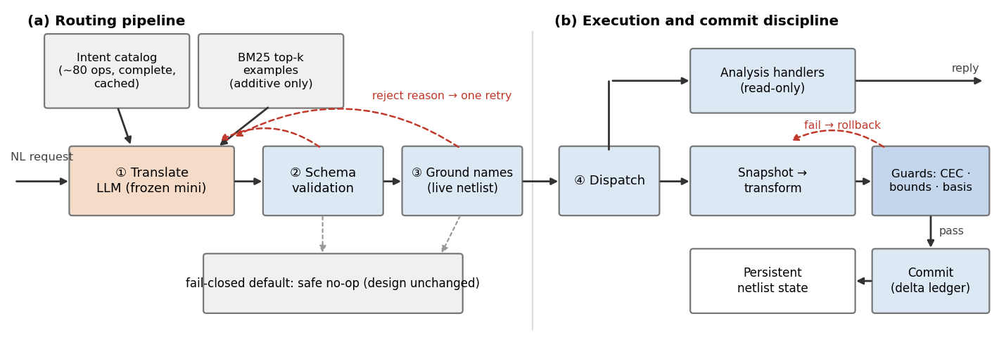

# Routing, Not Reasoning: A Fail-Closed LLM Agent for Natural-Language Netlist Transformation

> Draft v2 (2026-11-09).

## Abstract

Natural-language interfaces to EDA tools must interpret free-form requests
without compromising circuit correctness, often with models that cannot be
adapted. We present a fail-closed agent for natural-language netlist
manipulation that confines the LLM to translating each request into one intent
from a closed catalog of predefined operations. A deterministic engine executes
all circuit operations, and a mutation is committed only after a proof of
functional equivalence and checks of the operation's structural constraints;
otherwise it is rolled back. We state the assumptions under which committed
netlists remain equivalent and separate this functional guarantee from request
conformance, which it does not provide. On a 1,420-request paraphrase stress
set for the ICCAD 2026 CAD Contest Problem A, the full intent catalog reaches
88.4% routing accuracy with gpt-4o-mini, against 61.4% for a bare intent list
and at most 73.3% for supervised classifiers; claude-haiku-4.5 reaches 97.4%.
Fault injection exposed one guard-bypassing operation; after its repair, none
of 24 injected faults produced an unsafe commit, while 7 produced equivalent
but non-conforming edits.

## 1. Introduction

Natural-language (NL) interfaces are entering EDA flows, from design question
answering to tool-script generation and RTL repair [1]–[3]. Applied to
gate-level netlist manipulation, such an interface must meet two requirements
at once. First, correctness is not a quality score: a netlist whose function
has been silently altered is unusable downstream, which is why production
flows gate changes behind equivalence checking. Second, the design state
persists: requests arrive in sequence and operate on the netlist as earlier
requests left it, so an early error can shape every answer that follows.
These requirements often come with limited model capability. Organizations
that treat designs as confidential IP may prefer small, locally deployable
models [5]; benchmarks such as the ICCAD 2026 CAD Contest Problem A [6]
mandate frozen mini-class models; and few teams maintain a fine-tuning
pipeline.

When the LLM itself generates the executable artifact — a tool script, an
edited netlist, or RTL code — its errors have a direct path into the design.
Post-hoc checks catch many of them, but the failure surface is hard to bound,
and a smaller model raises the error rate the checks must absorb.

We take the opposite approach: the LLM routes; it does not rewrite. Its only
output is one intent object per request, drawn from a closed catalog of about
80 predefined operations with typed parameters. A deterministic engine
performs every circuit operation. Parameters that name nets or gates are
grounded against the current netlist before execution, and each mutation runs
on a snapshot that is committed only after a proof of functional equivalence,
obtained through a register-cut projection, and checks of the operation's
structural constraints; otherwise the snapshot is restored.

This architecture bounds what the LLM can damage, but not what it can
misunderstand. Under explicitly stated assumptions, every committed netlist is
functionally equivalent to its predecessor; a mis-routed request can still
commit a valid but unwanted edit, and that edit persists into later requests.
We therefore evaluate both sides: how accurately small frozen models route
requests, and which faults the guards prevent and which they cannot.

Our contributions are:

- **Architecture.** A constrained interface for NL netlist manipulation that
  separates LLM intent interpretation from deterministic execution and
  proof-gated commit, with an explicit statement of what it guarantees
  (functional integrity, under stated assumptions) and what it does not
  (request conformance) (§3).
- **Routing evaluation.** A controlled study on 1,420 paraphrased requests
  that compares a bare intent list, a full catalog, retrieval configurations,
  model choices, and supervised baselines, and analyzes the near-synonym
  operations behind most residual errors (§4.2–4.3).
- **Validation and limits.** Fault injection and the official contest
  evaluation, quantifying prevented violations, residual semantic drift, and
  one guard-bypassing operation that the experiment exposed and that we
  repaired (§4.4–4.5).

## 2. Problem Setting and Related Work

**Setting.** A session loads one flat gate-level Verilog netlist — two-input
primitive gates, inverters, buffers, and D flip-flops with asynchronous
control — and then receives free-form NL requests, one per line, answered in
lock-step [6]. Requests analyze (depth, cones, paths, equivalence), edit
(buffer insertion, basis conversion, renaming), or optimize (depth, gate count)
the current netlist. Hard requirements — functional equivalence where
requested, stated structural bounds, gate-basis restrictions — are
all-or-nothing: violating any one zeroes the testcase.

**LLM agents for EDA.** Script-generating agents emit tool scripts for EDA
flows and check them before execution [1], [7], [8]; flow-tuning agents search
a bounded parameter space [9], [10]; FluxEDA keeps backend instances alive so
that later steps observe earlier state [11]. RTL-oriented work generates or
repairs code against compilers and testbenches [2]–[4], and recent benchmarks
target netlist manipulation and tool calling [12], [13]. These systems differ
in how much execution freedom the LLM holds; in ours it holds none beyond
selecting one predefined operation and its parameters on a persistent
gate-level netlist.

**Structured tool calling.** Schema-constrained function calling is well
established [14]–[16], typically retrieving tool documentation into the
prompt. We instead retrieve labeled example requests, keep the full catalog in
every prompt, and validate name-typed parameters against a design state that
earlier requests have modified.

**Verified and checked execution.** LLM-Modulo argues for LLM generation behind
external verifiers [17]; obligation and transaction checks constrain agent
actions outside EDA [18]–[20]. Concurrent work on the same benchmark shows that
a run passing every equivalence check can still contain incorrect answers and
violated constraints, and adds request-derived completion checks [21]. That
work checks conformance, whereas ours bounds functional damage; the two are
complementary. Our contribution is therefore not a new verification primitive
but a commit protocol for persistent sequential netlists, state-aware
parameter grounding, and a measured account of what the combination prevents.

## 3. Fail-Closed Agent Design

**Fig. 1.** The fail-closed agent. (a) Routing (§3.2): the LLM only translates;
schema validation and name grounding against the live netlist return a
rejection reason for one corrective retry (dashed red), and every failure exit
ends in a safe no-op (dashed gray). (b) Commit protocol (§3.3): mutations run on
a snapshot that is committed only if all checks pass; otherwise it is rolled
back.

### 3.1 Closed-world intent interface

The catalog defines about 80 intents covering analysis (counts, depth, cones,
paths, connectivity, functional properties), transformation (basis remapping,
buffer insertion, cleanup, renaming), and optimization (depth, gate count). Each
intent declares required and optional parameters with types; enumerated
parameters such as the gate basis have closed value sets. The catalog text — a
description of each intent plus disambiguation entries for operations that
users phrase similarly — is part of every prompt as a fixed, cacheable prefix
of about 12.8k tokens. Retrieval only adds examples and never removes catalog
entries, so a retrieval miss cannot put the correct operation out of the
model's reach.

The operation space is closed; the parameter space is not. Which net, cone,
bound, or basis an operation applies to is decided per request. A request that
maps to no catalog operation yields a safe no-op that reports the design
unchanged. Extending the catalog means adding a handler, a schema, and a
disambiguation entry — an auditable engineering change rather than model
retraining.

### 3.2 Routing with live-state grounding

Routing proceeds in four stages (Fig. 1a). (1) *Translation:* the LLM receives
the catalog and the 50 most similar labeled requests, retrieved by BM25 from a
bank of 940 requests drawn from the contest's public and beta rounds, and emits
one JSON intent object. (2) *Schema validation:* an unknown intent, a missing
parameter, or an illegal enumerated value is rejected, and the rejection reason
is returned to the LLM for one corrective retry. (3) *Name grounding:* every
parameter that must name a net, gate, or flip-flop is checked against the
current netlist, which earlier requests may have modified; a nonexistent name
triggers re-translation with the error message. (4) *Dispatch* to a
deterministic handler: analysis handlers run graph algorithms on the netlist
IR, and mutation handlers enter the commit protocol of §3.3. Translations are
cached within a session, and if every stage fails the agent returns the safe
no-op.

### 3.3 Guarded execution and commit protocol

A mutation handler transforms a snapshot of the netlist (Fig. 1b), and three
checks decide whether the snapshot replaces the current design.

1. **Functional equivalence.** A register-cut projection turns the sequential
   netlist into a combinational one: each flip-flop's D, CK, RN, and SN pins
   become pseudo-outputs and its Q pin a pseudo-input. Flip-flops correspond by
   instance identity, and a change to the register set is rejected outright.
   Because every flip-flop input is observed, combinational equivalence of the
   projections implies sequential equivalence for the testbed's flip-flop
   model, including logic on clock and asynchronous pins. ABC's `cec` decides
   equivalence [22], with a yosys check as a fallback.
2. **Structural bounds.** Bounds carried by the operation, such as a maximum
   fanout, are recomputed on the result.
3. **Basis purity.** If the operation restricts gate types, the gate-type set
   of the result is checked.

The acceptance rule is fail-closed: the snapshot is committed only when every
check passes and equivalence is proved. A disproof, a timeout, or an
inconclusive result — for instance on a malformed netlist — restores the
snapshot. Candidates produced by the optimizer, including precomputed
candidates that serve as search seeds, obey the same rule. Committed mutations
are recorded in a delta ledger that later requests ("how many buffers were
added?") query.

### 3.4 Scope of the guarantee

We distinguish three properties of a committed edit: *functional integrity*
(the netlist computes the same function), *structural validity* (it meets the
bounds and basis of the routed operation), and *request conformance* (the
routed operation is what the user asked for). The architecture targets the
first two, under three assumptions:

- **(A1) Complete mediation.** Every operation that mutates the netlist,
  including renaming, executes through the commit protocol.
- **(A2) Sound checking.** A proof of equivalence reported by the checker is
  correct for the projected circuits.
- **(A3) Faithful projection.** The register-cut model matches the flip-flop
  semantics of the netlist.

Under A1–A3, every committed netlist is functionally equivalent to its
predecessor and structurally valid for the routed operation. Request
conformance is not guaranteed: a mis-routed request can commit an equivalent
but unwanted edit, and because the design persists, that edit changes what
later requests observe — for example, a gate count or a net name that a later
question depends on. The guards also enforce only the requirements carried by
the current operation, not constraints established by earlier requests. A1 is
the assumption most exposed to implementation error, and §4.4 tests it
directly.

## 4. Evaluation

### 4.1 Setup

**Requests.** We evaluate routing on a stress set of 1,420 requests that our
team wrote during the contest by paraphrasing the official request patterns:
71 operations with 20 paraphrases each, of which 1,065 use deliberately
indirect or unusual wording and 355 use standard phrasing. The set provides
ground-truth intents and parameters but no netlists, so we score the
translation output directly. The retrieval bank of 940 requests from the
contest's public and beta rounds is disjoint from the stress set. A second,
high-recall bank of 2,130 author-written paraphrases contains paraphrases of
the same operations as each test request; we use it with leave-one-testcase-out
(LOCO) exclusion and only as an upper bound, because it shares the stress set's
distribution. Since the catalog's disambiguation entries were refined during
the contest while inspecting errors on this set, accuracies on it may be
optimistic.

**Metric and models.** The primary metric is intent accuracy: whether the
selected operation is correct. We use the two contest-mandated models,
gpt-4o-mini and claude-haiku-4.5, at temperature 0.2, and repeat the
gpt-4o-mini headline settings five times (N=5). Evaluation rounds run strictly
one at a time, and a round with any degraded API call is discarded: we once
observed rate limiting silently convert LLM calls into no-op responses and
depress a measured accuracy from 97.8% to 67.2%.

### 4.2 Routing accuracy

**Table 1.** Intent accuracy on the 1,420-request stress set. Ranges span N
runs. †Upper bound: the bank shares the stress set's distribution.

| Router | Labeled data used | Intent acc. | N |
|---|---|---|---|
| BM25 nearest neighbor | production bank | 47.4% | — |
| SBERT embedding + kNN | all labeled requests (LOCO) | 72.8% | — |
| TF-IDF + linear SVM | all labeled requests (LOCO) | 73.3% | — |
| gpt-4o-mini, bare intent list | — | 61.4% | 1 |
| claude-haiku-4.5, bare intent list | — | 78.7% | 1 |
| gpt-4o-mini, full catalog | — | 88.4% (88.3–88.7) | 5 |
| gpt-4o-mini, catalog + retrieval (k=50) | production bank | 88.9% (88.6–89.2) | 5 |
| gpt-4o-mini, catalog + retrieval (k=50)† | high-recall bank (LOCO) | 95.1 / 95.6% | 2 |
| claude-haiku-4.5, catalog + retrieval (k=50) | production bank | 97.4% | 1 |

**Catalog information is the largest lever.** A bare list of intent names
yields 61.4% with gpt-4o-mini; the full catalog — descriptions, parameter
schemas, and disambiguation entries together — raises it to 88.4% (+27.0
points). The bare condition keeps the schema-feedback retry, whose fixed
message mentions class-level depth intents, and contains no other catalog text.
The gap between the two models is 17.3 points with the bare list and 8.5 points
with the full pipeline, so the catalog helps the weaker model more.

**Supervised baselines underperform.** With every labeled request available,
the best classifier reaches 73.3% (TF-IDF features with a linear SVM), and
frozen sentence embeddings reach 72.8%. Classifiers and LLMs are scored on the
same operation-level metric; the LLM additionally fills in parameters (84.6%
parameter accuracy for gpt-4o-mini with the catalog, 94.1% for
claude-haiku-4.5 with retrieval), which the classifiers do not attempt. With
only the production bank, three operations have no examples and are
unreachable for nearest-neighbor routing, whereas the LLM reaches them through
the catalog.

**Retrieval value depends on the bank and the model.** With the production
bank, retrieval adds only 0.5 points for gpt-4o-mini, and retrieval depth
barely matters: k from 5 to 100 spans 88.1–89.4% without a monotone trend,
while label recall rises from 60% to 86%. The high-recall bank adds 6.4 points
(an upper bound), and claude-haiku-4.5 reaches 97.4% on the production bank,
whose label recall at k=50 is only 82.1%. A stronger model thus needs less help
from retrieval; for the weaker model, bank quality matters, and its effect
(+6.4 points) is comparable to switching models (+8.5 points at a fixed
configuration).

### 4.3 Failure analysis

Moving gpt-4o-mini from the production to the high-recall bank removes 84% of
give-ups (44 to 7) but only 43% of wrong-operation picks (110 to 63): good
examples mainly help the model recognize unfamiliar phrasing. What remains is
dominated by confusions between semantically similar operations, such as
primary-input-to-output depth versus global maximum depth, or floating versus
dangling nets, and part of it reflects genuine ambiguity in the requests. The
supervised baselines confuse the same operation families. The concurrent agent
of [21], built on a different architecture, reports the same kind of scope
error on this benchmark (a pairwise depth of 10 reported as the whole-design
depth of 53). On this request distribution, near-synonym discrimination is a
major source of residual routing errors.

### 4.4 Fault injection

To test A1 and the guards, we corrupt routing output at the dispatch layer,
simulating worst-case LLM behavior: numeric bounds off by one in either
direction, a wrong but implemented basis or transformation, a basis outside the
closed world, a target redirected to a different existing net, a swap to a
different intent, and a function-changing rewire injected inside the engine. We
run 24 injections over six transformation-heavy public testcases (the six
uncorrupted runs pass all checks) and classify each final netlist against the
hard requirements of the original request (Table 2).

**Table 2.** Fault-injection outcomes (24 injections; classes are mutually
exclusive).

| Outcome | Meaning | Before fix | After fix |
|---|---|---|---|
| Rejected | refused before execution (closed-world value or name collision) | 2 | 5 |
| Rolled back | equivalence disproved; snapshot restored | 3 | 3 |
| Benign | corrupted edit still met every hard requirement of the request | 9 | 9 |
| Drift | equivalent and valid for the routed operation, but non-conforming | 7 | 7 |
| Unsafe | non-equivalent netlist committed | 3 | 0 |

Only rejections and rollbacks are detections; the nine benign cases passed
because the corrupted edit happened to remain acceptable. The three unsafe
commits shared one cause, a violation of A1: renaming was treated as cosmetic
and bypassed the commit protocol, so renaming a net onto an existing name merged
two drivers while the agent reported success. In one of these cases ABC
returned an inconclusive result on the double-driven net, which an evaluation
harness that treats inconclusive results as passing would have accepted. After
we added a check that rejects renames onto existing names, no injection
produced an unsafe commit, and the 40 public testcases pass all 84 of their
hard-requirement checks. The seven drift cases mark the conformance boundary of
§3.4: the guards enforced the corrupted operation's contract rather than the
user's sentence, and the response claimed success. Detecting them requires
request-level completion checks such as those of [21].

### 4.5 Official evaluation and post-contest analysis

In the contest's final round (100 testcases and 674 requests, unseen during
development), the submitted configuration met every hard requirement and
scored 671.366 of 674 under official scoring. All losses came from optimization
requests, which are scored by their cost relative to the best cost among all
entries. Table 3 compares the official result with two post-contest
re-evaluations of the same 46 optimization requests.

**Table 3.** Optimization score on the 46 final-round optimization requests.

| Run | Score (/46) | Compute |
|---|---|---|
| Official evaluation | 43.366 | 1 run, 300 s per request |
| Re-run, same configuration | 43.514 | 1 run, 300 s per request |
| Best of up to four runs | 43.983 | up to 4 runs, including an earlier engine version |

A single re-run under the same per-request budget improves 15 requests and
worsens 4, for a net gain of 0.148: the optimizer's search is budget-bound and
stochastic, and one run is far from its best achievable result. Taking the best
of up to four runs, at up to four times the compute, adds 0.617; all 17 improved
netlists were re-verified independently with ABC, and four of them beat the
best cost among all contest entries. These figures are post-contest upper
bounds, not a comparison under the official protocol. Three requests resist
re-sampling entirely (1.41 points) and call for algorithmic improvement.

## 5. Limitations and Conclusion

**Limitations.** We evaluate on one benchmark. The routing stress set was
written by the authors and the catalog refined against it, so its accuracies
may be optimistic; the official final round provides an out-of-sample,
end-to-end check. The cloud mini-class models stand in for the small, locally
deployable models that motivate this work, and direct validation on open-weight
models remains future work. Some settings were run once (N=1). The functional
guarantee rests on A1–A3 and on a correct implementation of them, and
drift — valid but non-conforming edits — is outside its scope.

**Conclusion.** Restricting the LLM to selecting predefined operations, and
committing their results only on proof, bounds the functional damage that an
LLM error can cause in persistent netlist manipulation, under assumptions that
can be stated and tested; fault injection found and closed a gap in the
assumption most exposed to implementation error. What the architecture does not
bound — whether the executed operation is the one the user meant — remains, and
our routing study locates most of it in near-synonym operations. For agents
that edit an existing design, safe execution and request conformance are
separate problems, and each needs explicit treatment.

*Acknowledgment.* AI coding assistants were used for implementation, data
post-processing, and language editing; all AI-assisted output was reviewed and
revised by the authors, who take full responsibility for the content.

## References

[1] H. Wu, Z. He, X. Zhang, X. Yao, S. Zheng, H. Zheng, and B. Yu, "ChatEDA: A large language model powered autonomous agent for EDA," *IEEE Trans. Comput.-Aided Design Integr. Circuits Syst.*, vol. 43, no. 10, pp. 3184–3197, 2024.

[2] Y. Tsai, M. Liu, and H. Ren, "RTLFixer: Automatically fixing RTL syntax errors with large language models," in *Proc. DAC*, 2024.

[3] M. Liu, N. Pinckney, B. Khailany, and H. Ren, "VerilogEval: Evaluating large language models for Verilog code generation," in *Proc. ICCAD*, 2023.

[4] Y. Lu, S. Liu, Q. Zhang, and Z. Xie, "RTLLM: An open-source benchmark for design RTL generation with large language model," in *Proc. ASP-DAC*, 2024.

[5] M. Liu *et al.*, "ChipNeMo: Domain-adapted LLMs for chip design," arXiv:2311.00176, 2023.

[6] C.-H. Chou, H.-C. Chiu, C.-J. Hsu, and Y. Liu, "ICCAD Contest Problem A: LLM-assisted netlist exploration and transformation," problem specification and Q&A, 2026.

[7] G. Pasandi *et al.*, "JARVIS: A multi-agent code assistant for high-quality EDA script generation," arXiv:2505.14978, 2025.

[8] B.-Y. Wu, U. Sharma, A. Rovinski, and V. A. Chhabria, "OpenROAD Agent: An intelligent self-correcting script generator for OpenROAD," in *Proc. IEEE ICLAD*, 2025, pp. 16–22.

[9] A. Ghose, A. B. Kahng, S. Kundu, and Z. Wang, "ORFS-agent: Tool-using agents for chip design optimization," in *Proc. ACM/IEEE MLCAD*, 2025, pp. 1–13.

[10] K. Li, S. Yao, S. Zheng, and L. Wang, "StateTune: Transforming LLM-assisted EDA flow tuning into a stateful, closed-loop process," in *Proc. IEEE/ACM ICCAD*, 2026.

[11] Z. Chen, Z. Song, Y. Li, Q. Sun, and C. Zhuo, "FluxEDA: A unified execution infrastructure for stateful agentic EDA," arXiv:2603.25243, 2026.

[12] J. Ma, J. Wang, Y. Ma, Z. Zhuang, and X. Liu, "NetlistBench: Evaluating LLM reliability in SPICE netlist recognition and manipulation," arXiv:2608.12197, 2026.

[13] F. Liparulo and F. Pierri, "Benchmarking AI agents for hardware design automation via MCP tool calling," arXiv:2608.26199, 2026.

[14] S. G. Patil, T. Zhang, X. Wang, and J. E. Gonzalez, "Gorilla: Large language model connected with massive APIs," in *Proc. NeurIPS*, 2024.

[15] Y. Qin *et al.*, "ToolLLM: Facilitating large language models to master 16000+ real-world APIs," in *Proc. ICLR*, 2024.

[16] S. G. Patil *et al.*, "The Berkeley Function Calling Leaderboard (BFCL): From tool use to agentic evaluation of large language models," in *Proc. ICML*, 2025.

[17] S. Kambhampati *et al.*, "Position: LLMs can't plan, but can help planning in LLM-Modulo frameworks," in *Proc. ICML*, 2024.

[18] F. Batole, F. Khomh, and H. Rajan, "RefineAct: Automatic runtime verification of LLM agent actions," in *Proc. IEEE/ACM ASE*, 2026.

[19] Y. Liu *et al.*, "ToolGate: Contract-grounded and verified tool execution for LLMs," in *Findings of ACL*, 2026, pp. 9653–9684.

[20] S. Yao, N. Shinn, P. Razavi, and K. Narasimhan, "$\tau$-bench: A benchmark for tool-agent-user interaction in real-world domains," in *Proc. ICLR*, 2025.

[21] "Beyond equivalence: Checking task completion in LLM-based netlist analysis, editing, and optimization," concurrent submission, 2026.

[22] R. Brayton and A. Mishchenko, "ABC: An academic industrial-strength verification tool," in *Proc. CAV*, LNCS 6174, 2010, pp. 24–40.
